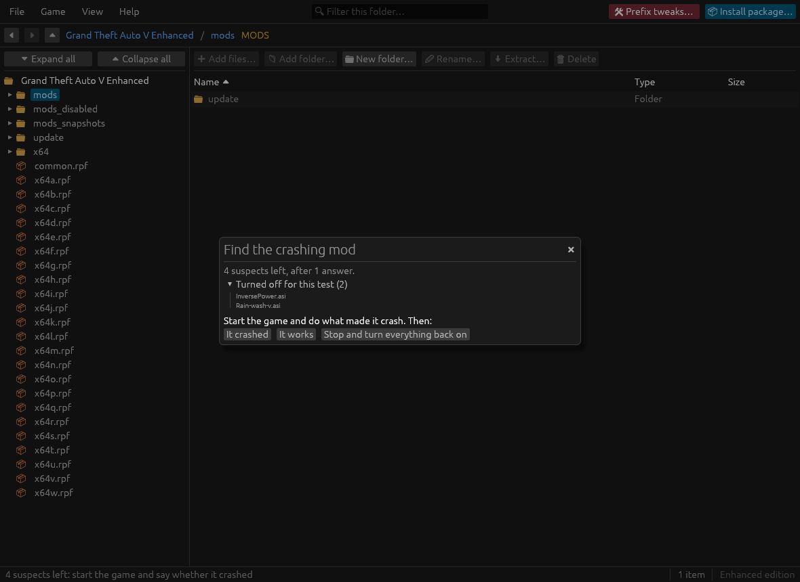

# Paleto Modkit

<p align="center">
  
</p>

<p align="center">
  <b>Native Linux tool for Grand Theft Auto V modding, Legacy and Enhanced editions.</b><br>
  Browse and edit the game's archives, install mods, and find out why the game broke, without Wine.
</p>

<p align="center">
  <a href="https://github.com/the-beper/paleto-modkit/releases"></a>
  <a href="https://github.com/the-beper/paleto-modkit/releases"></a>
  
</p>

> [!WARNING]
> **A personal, experimental project.** I started it to fix the problems I had with GTA V modding tools on Linux. Most of the code was written by AI ([Claude Code](https://claude.com/claude-code)); I tested it by hand and reviewed parts of it. Expect rough edges.
>
> - **Your game files are safe by design**: originals are never modified, every change goes to the `mods/` folder.
> - **Tested against every file of both editions**, but not every change has been tried in game, especially on Enhanced.
> - **Single player only**: modified files in GTA Online get you banned.


## What it does

**Browse and edit**
- Open `.rpf` archives like folders, nested ones included; add, extract, rename and delete files.
- Edit XML and `.meta` files, and binary metadata (`.ymt`, `.ytyp`, `.ymap`, `.pso`) as XML.
- View, export and replace textures (`.ytd`) from DDS or PNG; preview 3D models; play and replace sounds.

**Install mods**
- Install `.oiv` packages and add-on packs (`dlc.rpf`), with the DLC list updated for you.
- On Enhanced, convert models and textures made for Legacy, built in (CodeWalker's converter, no Wine).
- Export your own changes as an `.oiv`, to share them or reinstall them later.
- **Prefix tweaks** (Linux): prepare the game's Wine prefix for ScriptHookVDotNet mods (installs .NET Framework 4.8), with a backup of the prefix.

**When the game breaks**
- **Mods in game**: is the ASI loader in place, does Script Hook V match the game, which mods did the game actually read.
- **Last crash**: a plain reading of the game's crash dump, down to a full asset store and the pack that was loading.
- **Find the crashing mod**: turn mods off by halves until the culprit is left.
- **Snapshots** of the mods folder, instant on btrfs and XFS.

Most of it also works from a terminal, with the `paleto` command.

## Gallery

| Texture Dictionary Viewer (`.ytd`) | Binary Metadata as XML (`.ymt`) |
| :---: | :---: |
|  |  |
| **Mods in game** | **OpenIV Package Installer (`.oiv`)** |
|  |  |
| **Audio Preview (`.awc`)** | **Find the crashing mod** |
|  |  |

## Install

Download from [GitHub Releases](https://github.com/the-beper/paleto-modkit/releases):

```bash
# Flatpak (needs the Flathub remote for its runtime)
flatpak install --user PaletoModkit-x86_64.flatpak

# or AppImage
chmod +x PaletoModkit-x86_64.AppImage && ./PaletoModkit-x86_64.AppImage
```

A tarball and building from source are covered in [docs/installation.md](docs/installation.md).

## Getting started

1. **Open the app.** It finds GTA V in your Steam libraries, and reads the encryption keys from the game the first time.
2. **Set up the game to load mods**: an ASI loader plus `OpenIV.asi` (Legacy) or [`OpenRPF.asi`](https://www.gta5-mods.com/tools/openrpf-openiv-asi-for-gta-v-enhanced) (Enhanced). Under Proton, add `WINEDLLOVERRIDES="xinput1_4=n,b" %command%` (or `dinput8=n,b`) to the game's launch options. [Details](docs/installation.md#what-the-game-needs-to-load-your-mods).
3. **Install a mod**: drop its `.oiv` or `dlc.rpf` on the window.
4. **Check it**: **Game → Mods in game** tells you whether the game will load it and, after you play, whether it did.

## Documentation

- [Installation](docs/installation.md): every install method, the encryption keys, the game setup.
- [User guide](docs/user-guide.md): browsing and editing, textures, models, audio, shortcuts.
- [Installing and managing mods](docs/mods.md): OIV packages, add-on packs, Legacy → Enhanced conversion, export, clean-up.
- [When the game breaks](docs/troubleshooting.md): mods check, crash report, crash hunt, snapshots, common problems.
- [Command line](docs/cli.md): every `paleto` command.
- [OIV packages](docs/oiv.md): the supported package actions.
- [Development](docs/development.md): project layout, building, tests, packaging.

Found a problem? [Open an issue](https://github.com/the-beper/paleto-modkit/issues) with the steps to reproduce it and, if you can, the file involved.

## License

GPL-3.0-or-later. See [LICENSE](LICENSE), and [THIRD_PARTY.md](THIRD_PARTY.md) for the third-party code and data it uses.

*Paleto Modkit is an independent open-source project, not affiliated with or endorsed by Rockstar Games, Take-Two Interactive or the OpenIV team.*
