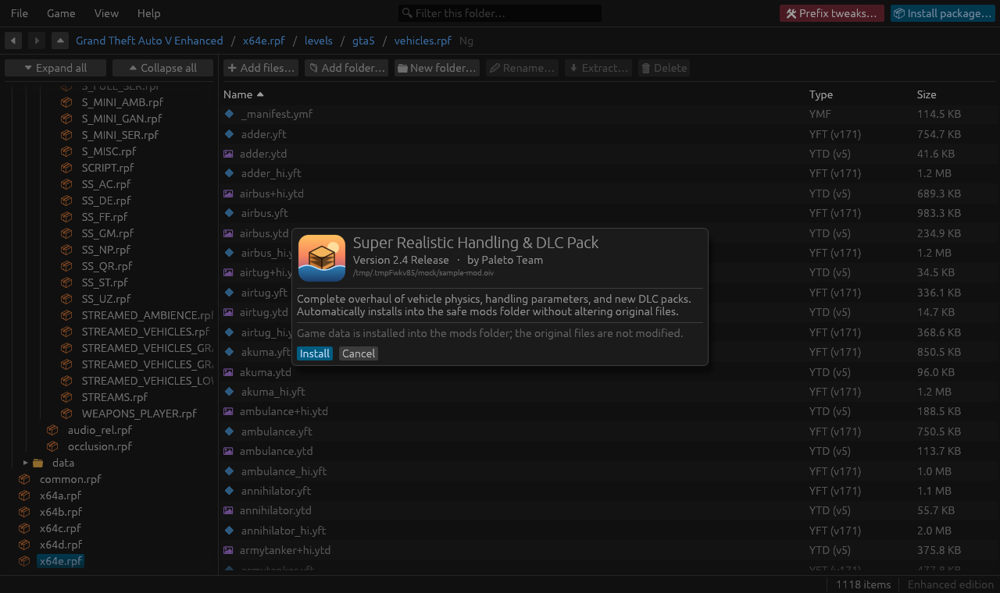
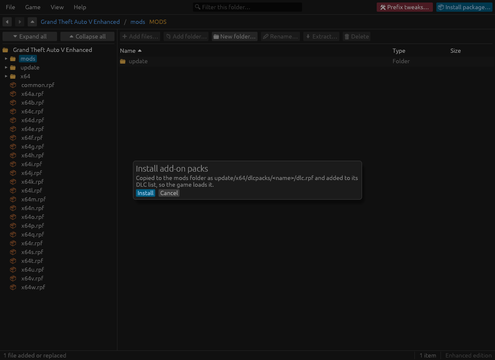
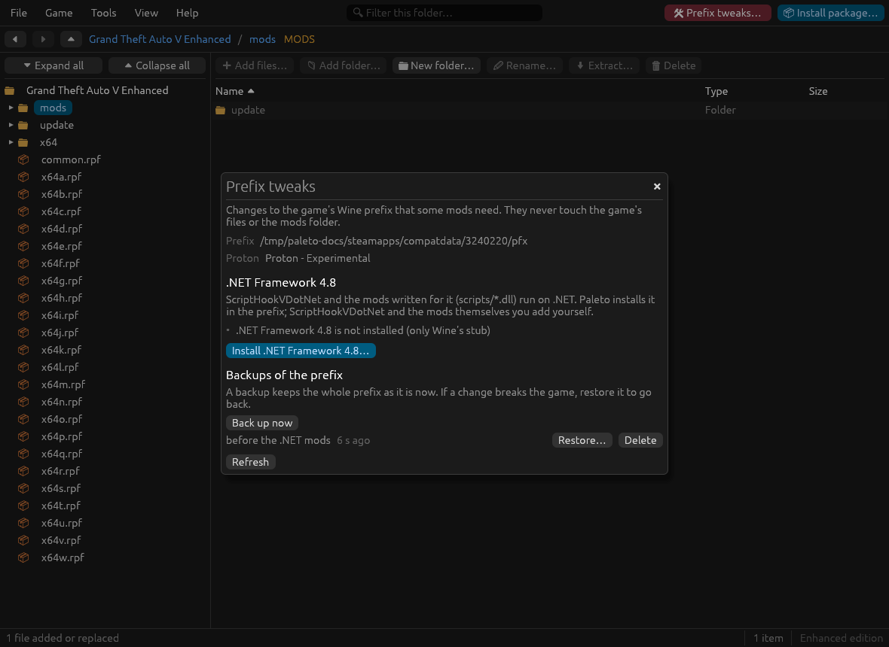
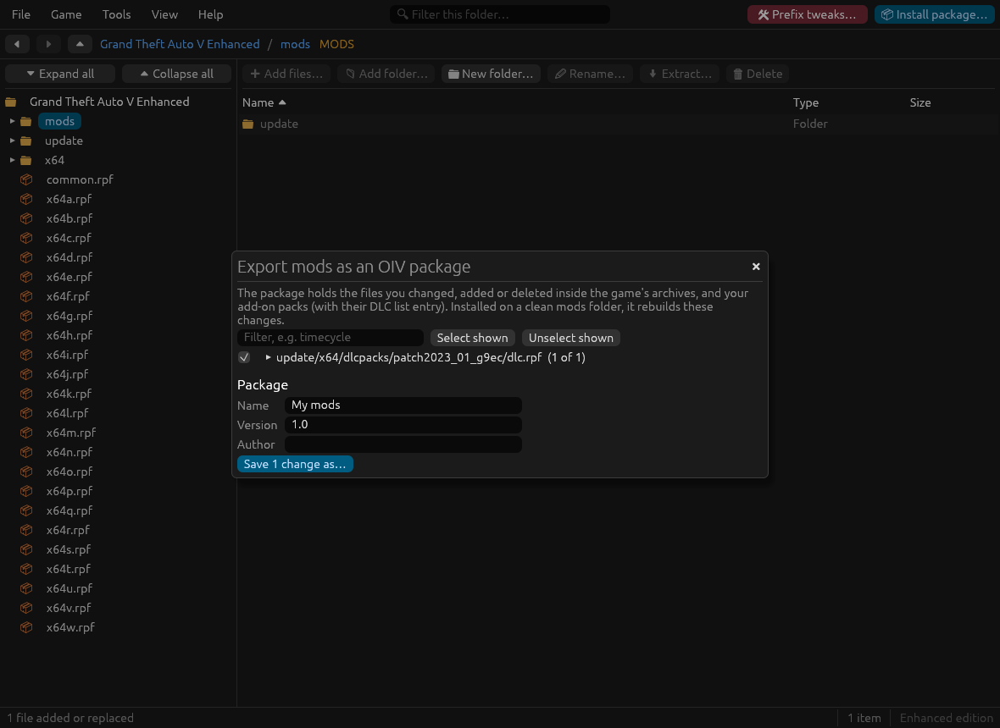

# Installing and managing mods

- [The mods folder](#the-mods-folder)
- [OIV packages](#oiv-packages)
- [Add-on packs](#add-on-packs)
- [Legacy files on the Enhanced edition](#legacy-files-on-the-enhanced-edition)
- [ScriptHookVDotNet mods (.NET) on Linux](#scripthookvdotnet-mods-net-on-linux)
- [Exporting your mods as an OIV package](#exporting-your-mods-as-an-oiv-package)
- [Cleaning up the mods folder](#cleaning-up-the-mods-folder)

## The mods folder

The game reads its data from archives (`.rpf`) in its folder. With an ASI loader and `OpenIV.asi` (Legacy) or `OpenRPF.asi` (Enhanced), it first looks in the `mods/` folder: an archive at `mods/update/update.rpf` is read instead of `update/update.rpf`. See [installation.md](installation.md#what-the-game-needs-to-load-your-mods) for setting them up.

Paleto Modkit relies on this: it never changes the game's own files. Every change to an original archive goes to its copy in `mods/`, made the first time. To undo everything, delete `mods/`; to keep a known good state, take a [snapshot](troubleshooting.md#snapshots-of-the-mods-folder).

Things Paleto Modkit keeps next to `mods/`, in the game folder:

| Folder | What it holds |
| :--- | :--- |
| `mods_snapshots/` | [Snapshots](troubleshooting.md#snapshots-of-the-mods-folder) of the mods folder |
| `mods_legacy/<time>/` | The Legacy files replaced by a [conversion](#legacy-files-on-the-enhanced-edition), to undo it |
| `mods_disabled/` | What [Crash detection](troubleshooting.md#find-the-culprit-by-elimination) turned off while it runs |

## OIV packages

`.oiv` is OpenIV's package format, the most common way mods are shared. Open one with **Install package…** (top right), by dropping it on the window, or from your file manager.

The installer shows the package's name, version, author and description before anything happens. **Install** then applies it:

- game data goes into the mods folder (original archives are copied there first);
- plugins and scripts (`.asi`, `.dll`, `scripts/`) go to the game folder, as the package says;
- the log lists every change, with warnings where the package expected something the game files do not have.

Paleto Modkit supports OIV format 2.x: adding and deleting files, nested archives, text edits, XPath edits of XML files and of binary metadata, and archive defragmentation. [oiv.md](oiv.md) lists what each action does.

On the Enhanced edition, files made for Legacy in the package are noticed before installing, and can be converted while installing (see [below](#legacy-files-on-the-enhanced-edition)).

## Add-on packs

Add-on cars, maps and other new content usually come as a DLC pack: a `dlc.rpf` the game loads from `update/x64/dlcpacks/<name>/`, once its name is in the DLC list (`dlclist.xml`, inside `update.rpf`).

**Install package…** (top right) with a `dlc.rpf`, or dropping a `dlc.rpf` (or a mod's folder holding one) on the window, does both steps:

1. It copies the pack to `mods/update/x64/dlcpacks/<name>/dlc.rpf`. The name comes from the mod's folder, or from the pack's own `setup2.xml` when the folder has a generic name; you can change it (letters, digits, `_` and `-`).
2. It adds the pack to the DLC list in the mods copy of `update.rpf`.

Packs copied into the mods folder by hand, but missing from the DLC list, are found by **Tools → Mods in game**, which can add them (see [troubleshooting.md](troubleshooting.md#mods-in-game)).

## Legacy files on the Enhanced edition

The Enhanced edition stores models, textures and particles in a newer format. It cannot read the ones made for Legacy (`.ydr`, `.ydd`, `.yft`, `.ytd`, `.ypt`), and may crash or show nothing when a mod ships them; most mods on the internet were made for Legacy.

| File | Legacy version | Enhanced version |
| :--- | :---: | :---: |
| `.ytd` (textures) | 13 | 5 |
| `.ydr`, `.ydd` (models) | 165 | 159 |
| `.yft` (vehicles, fragments) | 162 | 171 |
| `.ypt` (particles) | 68 | 71 |

Paleto Modkit converts them with [CodeWalker](https://github.com/dexyfex/CodeWalker)'s converter, which it ships as `paleto-cwconv`: a native Linux build of CodeWalker's own code, with its own .NET runtime, no Wine needed. It converts them:

- **when you install an OIV package**: the Legacy files are converted before they reach `mods/`, inside the package's `dlc.rpf` too;
- **when you install an add-on pack**;
- **when you add files or folders to an archive** (drag and drop, **Add files…**): the files on disk are left alone;
- **for files already in `mods/`**, such as packs copied by hand: **Tools → Mods in game** marks them and offers **Convert to Enhanced**.

Each time, a dialog says how many files were made for Legacy and lets you install them as they are instead. A conversion still running after a minute per file (plus one) is stopped, and fails with that message.

The app also checks the mods folder in the background when it starts, and warns in the status bar when it finds Legacy files. Only archives changed since the last check are read again, so this takes a moment the first time only.

**Undo**: the Legacy files replaced in `mods/` are kept in `mods_legacy/<time>/`. **Undo the last conversion** in the Maintenance section of **Mods in game** puts them back.

**Limits**:

- Data files (`.xml`, `.meta`, `.ymt`, `.ymap`, `.dat`) are the same in both editions and need no conversion.
- When files are converted on the way in (**Add files…**, drag and drop), all the files of that addition are read into memory first: one over 1 GiB, or 4 GiB in all, is refused with a message that names the limit. Add them in smaller groups, or install them as they are. An add-on pack is copied from file to file instead, up to 8 GiB.
- Audio data (`.rel`) made for Legacy may not work on Enhanced; it is not converted.
- Conversion was checked in game with textures (`.ytd`) and vehicles (`.yft`); models (`.ydr`, `.ydd`) and particles (`.ypt`) are converted the same way, but have not been tried in game yet.

## ScriptHookVDotNet mods (.NET) on Linux

Mods written for ScriptHookVDotNet (a `scripts` folder with `.dll` files) need the real **.NET Framework 4.8** in the game's Wine prefix. Wine only has stubs, and installing .NET by hand with winetricks fails in a Proton prefix. **Prefix tweaks** (the wine-red button at the top right, beside Install; it has no menu entry) prepares the prefix for you:

1. It finds the game's prefix (`steamapps/compatdata/<app id>/pfx`) and the Proton the game last ran with (when that tool was renamed, the one Steam's `CompatToolMapping` names for the game is used). For a game Steam knows as a non-Steam game (its app id is a long number of its own) or one outside Steam's library, the window offers **Choose prefix folder…**: pick the game's `compatdata/<app id>` folder (the one with `pfx` inside; it must have been started once with Proton). Paleto remembers the choice; **Use Steam's prefix again** forgets it. This also works for the folders other launchers make (Faugus, for example), which have the same `config_info` and `drive_c`; where `pfx` is only a link to the folder itself, the window warns in bold that the game must be closed first (Paleto cannot see it running), **Back up now** works but **Restore** is not supported: copy the folder yourself before changing it.
2. It backs the prefix up (instant and free on btrfs and XFS; a full copy elsewhere). Each prefix lists only its own backups, so after choosing another prefix folder the backups of Steam's prefix stay out of the way.
3. It downloads winetricks and Microsoft's installers once (about 120 MB), checked against fixed checksums, and installs .NET Framework 4.8 with the Proton's own Wine. It takes about five minutes. Microsoft's installer needs your graphical session for its windows, which it keeps hidden; the rest of the work runs cut off from the desktop, so no window or message box appears.
4. It sets the Windows version back (winetricks leaves Windows 7, and the game then refuses to start), and verifies the result.

Tried so far with one Proton build (Wine 11) and the native build of the app. In the Flatpak, Wine runs on the host through `flatpak-spawn --host` (the sandbox cannot run Proton's 32-bit Wine), which the Flatpak's permission to talk to `org.freedesktop.Flatpak` allows; without that permission the window and `paleto prefix dotnet` say so, and backups and restores still work. The game must be closed. A failed or cancelled installation can be undone with **Restore** in the same window. **Reinstall** or **Repair** runs it again, for example after changing the Proton version of the game.

Paleto does not install ScriptHookVDotNet, LemonUI or the mods: copy those to the game folder yourself. On Enhanced use **ScriptHookVDotNet Enhanced** (SHVDNE), and give its console a key the other mods do not use (`ConsoleKeyBinding` in `ScriptHookVDotNet.ini`). **Mods in game** shows whether the prefix is ready, and warns when ScriptHookVDotNet is installed without .NET. ScriptHookVDotNet needs Script Hook V, which the [Script Hook V window](troubleshooting.md#script-hook-v) keeps up to date. From a terminal: `paleto prefix` (see [cli.md](cli.md)).

## Exporting your mods as an OIV package

**File → Export mods as an OIV package…** turns what you changed into one `.oiv`, to share it, or to install it again after cleaning up or reinstalling the game.

1. It compares the mods folder with the game's files, nested archives included. The first time this reads every modded archive whole (about a minute and a half for a mods folder of 60 GB); after that, only the archives changed since. Closing the window stops it.
2. It lists the changes, grouped by archive: files changed, added or deleted, and add-on packs. Filter them by name and pick the ones to keep.
3. **Save N changes as…** writes the package, with the name, version and author you give it. Add-on packs come with their DLC list entry, added to the list of whoever installs the package.

Installed on a clean mods folder, the package rebuilds the same files. This was checked on a real Enhanced mods folder: 842 changes exported, installed on a clean copy of the game, and every file came back identical.

## Cleaning up the mods folder

Some mods (and some manual installs) leave copies of game files that they never changed. They slow loading, take space and hide the real changes.

**Tools → Mods in game → Maintenance → Clean-up → Look for them** reads the mods folder and lists the files identical to the game's own, with their total size. **Delete them** removes them; the game then reads its own files in their place. Each file is compared again just before it is deleted.

On a real Enhanced mods folder this found 96 such files, 34 GB.
