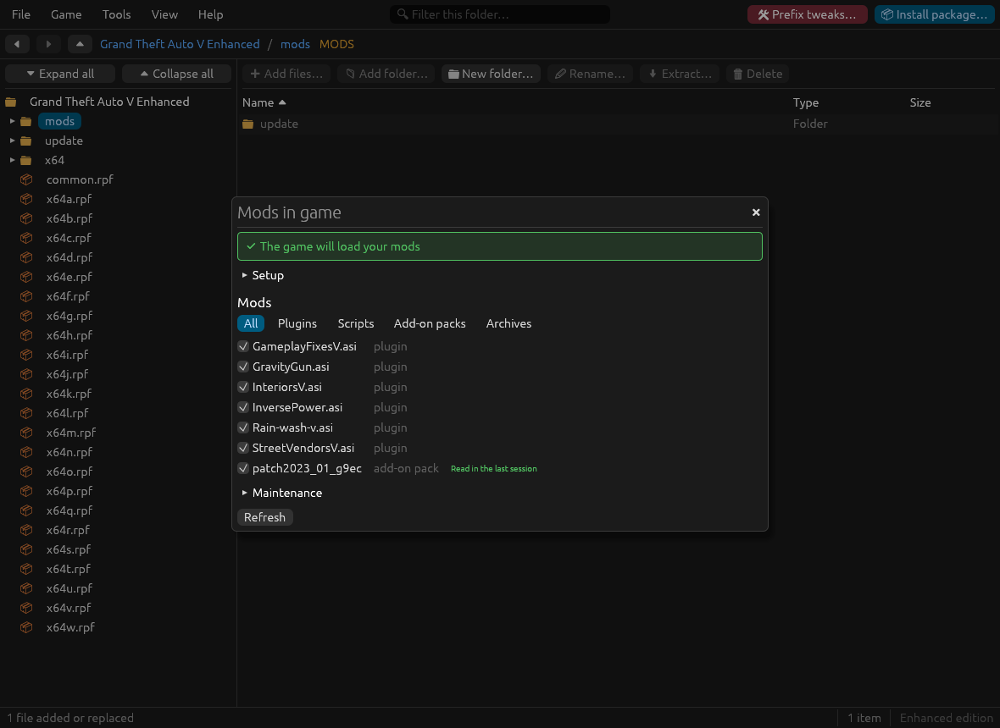
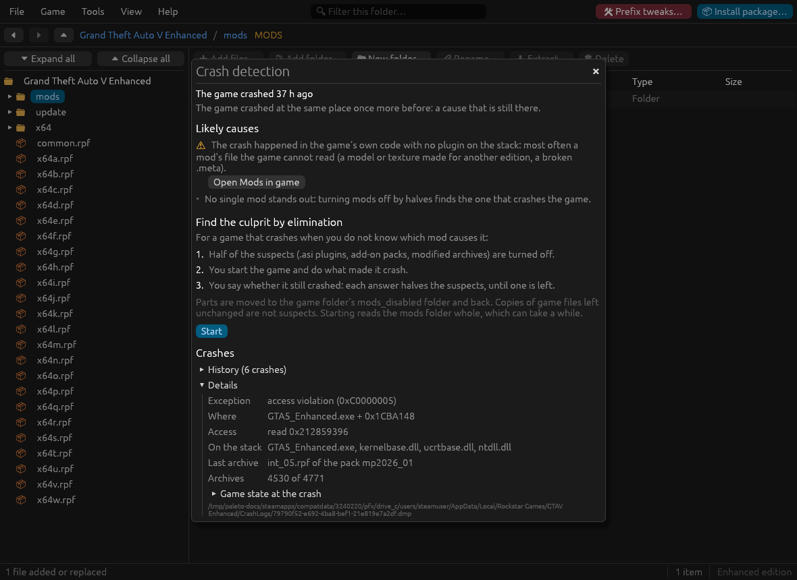
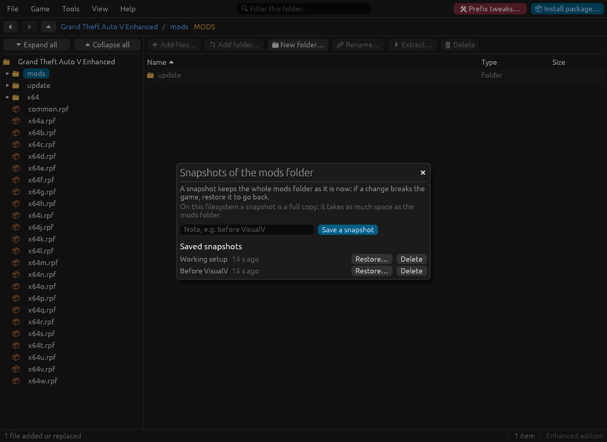

# When the game breaks

Tools for the usual questions: does the game load my mods, why did it crash, which mod is to blame, and how do I get back to a setup that worked. They are in the **Tools** menu, and in the command line (see [cli.md](cli.md#checks-and-troubleshooting)).

- [Mods in game](#mods-in-game)
- [Crash detection](#crash-detection)
- [Script Hook V](#script-hook-v)
- [Snapshots of the mods folder](#snapshots-of-the-mods-folder)
- [Common problems](#common-problems)

## Mods in game

**Tools → Mods in game** is the inventory of your mods: what is installed, whether the game will load it, and what it read the last time it ran.

| Part | What it shows |
| :--- | :--- |
| **Banner** | "The game will load your mods", or the first problem with its fix button. Further problems follow as warnings, each with its own button. |
| **Setup** (folded unless something is wrong) | The ASI loader (`dinput8.dll`, `xinput1_4.dll`…), `OpenIV.asi` (Legacy) or `OpenRPF.asi` (Enhanced) without which the game ignores the mods folder, Script Hook V (does it suit the game; see [Script Hook V](#script-hook-v)), and on Linux whether .NET is in the Wine prefix ([mods.md](mods.md#scripthookvdotnet-mods-net-on-linux)). |
| **Mods** | Every plugin (`.asi`), script mod, add-on pack and modified archive, with a checkbox to turn it off and on and these badges: read in the last session, not read by the game, not in the DLC list (**Add to DLC list**), older than the game update (plugins often stop working after one), turned off, not in the Enhanced format (**Convert to Enhanced**). The chips above the list filter by kind. The checkboxes are locked while an elimination search runs. |
| **Maintenance** | **Convert all to Enhanced** and **Undo the last conversion** ([mods.md](mods.md#legacy-files-on-the-enhanced-edition)); **Clean-up** of unchanged copies of game files ([mods.md](mods.md#cleaning-up-the-mods-folder)); the log of the last game session. |

The mods copy of `update.rpf` must not be older than the game: after a game update its DLC list lacks the new packs and the game does not load them. The banner then offers **Add to DLC list**.

The last-session marks come from the log `OpenIV.asi` or `OpenRPF.asi` writes, found in the game folder or in the Proton prefix; its errors are listed at the end of the Maintenance section. Without a log, start the game once and press **Refresh**. A mod marked "not read" usually has a wrong path, or its pack is missing from the DLC list.

## Crash detection

One window for "why did the game crash, and which mod is to blame": **Tools → Crash detection**. When the game crashes it writes a crash dump (`.dmp`) and a `crashcontext.log`; under Proton they are in the game's prefix (`compatdata/3240220/…/Rockstar Games/GTAV Enhanced/CrashLogs` for Enhanced).

| Section | What it shows |
| :--- | :--- |
| **Header** | When the game crashed, a plain reading (a plugin on the stack to update or remove, a mod file the game could not read, the graphics stack), and how many earlier crashes happened at the same place: a cause that is still there. |
| **Likely causes** | Problems, warnings and hints, most serious first, each with a button: **Update Script Hook V…** when it is older than the game, **Turn off** a plugin that is on the crash stack (or older than the game's last update), **Open Mods in game**, **Show the log** of a plugin that logged errors. When no single mod stands out it suggests the search below. |
| **Find the culprit by elimination** | The search by halves, below. While a search is going on it moves to the top and the other sections fold. |
| **History** | Every crash dump, newest first, with the exception, the module and offset, and how often it happened at the same place. Click one to read it in **Details**. |
| **Details** | The exception, the module and offset, the address read or written, the modules on the crashing thread's stack (`.asi` plugins among them are the usual suspects), the **last archive** the game mounted (with the add-on pack that holds it), how many **archives** were mounted of how many the game allows (at the limit a Packfile Limit Adjuster is needed), the **asset stores with no room left** and the **game state** from `crashcontext.log`. |
| **Plugin logs** | The error lines of the `.log` files in the game folder and its `scripts` folder, with their age. |

When the game crashed since you last looked, a notice opens at start with the plain reading and **Open Crash detection**. The first start only records the newest crash (inferred from the code, not observed).

The game keeps a fixed number of slots for each kind of file (textures, models, metadata…). When a store is **full**, the game stops on the next file it has to register; the window lists the full stores and those within 2% of it. The fix is a larger pool in `gameconfig.xml` (`common/data` in the mods copy of `update.rpf`) or a gameconfig made for mods. Then the reading names the store and the pack that was loading, which is usually enough without a search.

### Find the culprit by elimination

For a game that crashes when you do not know which mod causes it:

1. **Start**: half of the suspects are turned off. Suspects are the `.asi` plugins (except the one that reads the mods folder), the add-on packs, and the modified archives of the mods folder. Copies of game files left unchanged are not suspects.
2. You start the game and do what made it crash.
3. You answer **It crashed** or **It works**. Each answer halves the suspects, until one is left: about 6 game runs for 40 suspects.

The culprit stays turned off, so you can play to confirm it; then remove or update that mod. **Turn everything back on** (or **Stop**, at any time) puts everything back where it was.

Turned-off parts are moved to the game folder's `mods_disabled/` folder and back; the search survives closing the app. Each move is a single rename that never replaces anything (atomic, but outside the journaled change that records the state of the hunt and the files turned off inside an archive: if that change fails after parts were moved, the message says so, the next answer is refused because the state no longer matches what is on disk, and **Stop** puts them back).

**Look inside it**: when the culprit is an archive that holds several mods (the mods copy of `update.rpf` often does), the search can go on among its changed files. Files are turned off by putting the game's own version back in the archive, and restored afterwards. On a real Enhanced `update.rpf` with 621 changed files, this takes about 10 game runs, under half a second per step.

## Script Hook V

**Tools → Script Hook V** is for the library nearly every script mod depends on. It breaks after most game updates until its author releases a new build.

| Line | Meaning |
| :--- | :--- |
| **Installed** | The version of `ScriptHookV.dll` in the game folder. |
| **Latest** | The newest release on [dev-c.com](http://www.dev-c.com/gtav/scripthookv/), with the game builds it supports. **Retry** when the site could not be reached. |
| **Game version** | The version of the game's executable. |
| Verdict | Works (its own log says it started on this game), should work (its version is not older than the game's; inferred, not seen running), or does not suit this game. |

**Update to…** (or **Install…** when it is missing) downloads the release and replaces only `ScriptHookV.dll` in the game folder, **without a backup**. Nothing else is touched.

**Network**: when the app starts and Script Hook V is installed, it requests the dev-c.com page above (a plain GET with a browser-like user agent, nothing about you or your game is sent) to see whether there is a newer release. The download happens only when you press the update button. With Script Hook V not installed, nothing is requested at start. Two notices can follow:

- **Script Hook V update**: a newer release exists (**Update now** / **Not now**);
- **Script Hook V is not compatible with this game version**: it is older than the game, or its log says it failed (**Open Script Hook V**).

How the page is read (the HTML of dev-c.com) can break if the site changes; the window then says it could not read it. Unverified: behaviour of the check against the live site on every edition.

## Snapshots of the mods folder

**Tools → Snapshots of the mods folder** keeps the whole mods folder as it is now, so you can go back to it when a change breaks the game. Take one before installing something big.

- **Save a snapshot**, with an optional note ("Before VisualV").
- **Restore…** replaces the mods folder with a snapshot. By default the current mods folder is saved as a snapshot first, so a restore can be undone too.
- **Delete** removes a snapshot; the mods folder stays as it is.

A restore copies the snapshot beside `mods`, swaps the two folders, then removes the old one; if it stops half way, the next change puts the old mods folder back. A mods folder that is a link (to another drive, say) is not restored, since the swap would replace the link with a real folder: remove the link first (the folder it points to is kept), or copy the snapshot's `mods` folder into the linked folder by hand. Snapshots are kept in the game folder's `mods_snapshots/`. On btrfs, XFS and bcachefs a snapshot is instant and takes no space until files change (60 GB in a third of a second); on other filesystems it is a full copy, as big as the mods folder. The window says which applies.

## One change at a time, and interrupted changes

Anything that changes a game's files (installing a package or an add-on pack, snapshots, turning mods off, converting, cleaning up, installing Script Hook V, editing an archive or a loose file, renaming, deleting or making folders in the file browser) runs under a lock on that game. If another change to the same game is running, in this program or another one, you get a "busy" message that says which; wait for it to finish and try again. Other games, and everything that only reads, are not held up.

If a change is interrupted (a crash, a power cut, the program killed), it is undone, or its clean-up is finished if all its files were already in place, before anything else changes that game. If it cannot be undone (a backup was deleted by hand, a folder became read-only), the message names the files and their backups and nothing else is changed until that is sorted out.

| Where | What happens |
| :--- | :--- |
| Window | Choosing a game with an interrupted change opens "A change was interrupted", before any other notice, naming the change, its state and its files. **Undo** puts the files back (or finishes the clean-up) and then shows what was done. **Later** closes it; the next refused change brings it back, and until it is undone, changes to that game are refused with "An interrupted change must be undone first", while reading stays available. |
| Window, stuck change | For a change that cannot be undone, or whose journal cannot be read, **Abandon…** asks first and lists the files and backups the journal names. Confirming moves the journal to `.paleto/journal/abandoned/`; nothing is deleted or put back, so the files and backups it names stay for you to look at. |
| Command line | `paleto recover` undoes it and prints what was done (`recovered: …`). `paleto recover --status` lists the interrupted changes and the `.paleto-…` files no journal accounts for, and changes nothing. `paleto recover --abandon ID` does what Abandon… does, for the id `--status` shows. Every command that changes a game does the `recover` first and stops if it fails. |

Files called `.paleto-…` next to the game's files are this program's temporaries and backups; they are never deleted unless this program made them in the run that is finishing.

The `.paleto` folder in the game folder holds the lock (`lock`) and the records of changes in progress (`journal/`). Leave it alone; it is safe to keep.

## Common problems

**The game ignores the mods folder.** Check **Tools → Mods in game → Setup**. Under Proton, the ASI loader needs a DLL override in the launch options, for example `WINEDLLOVERRIDES="xinput1_4=n,b" %command%` ([installation.md](installation.md#what-the-game-needs-to-load-your-mods)).

**A mod worked, then a game update broke it.** Look at **Mods in game**: the mods copy of `update.rpf` may predate the update (add the new packs to its DLC list), Script Hook V may need its new version ([Script Hook V](#script-hook-v)), and plugins older than the update are marked.

**The Enhanced game crashes when a modded car or object appears.** Usually a model or texture made for Legacy. **Mods in game** marks them and converts them.

**An add-on pack does not show up in game.** It must be in the DLC list: **Mods in game** marks the packs that are not. Check also that the log shows its archive was read.

**ScriptHookVDotNet mods (a `scripts` folder with `.dll` files) do nothing, or the game stops at startup.** They need the real .NET Framework 4.8 in the game's Wine prefix: **Mods in game** says whether it is there, and **Prefix tweaks…** (the wine-red button at the top right) installs it ([mods.md](mods.md#scripthookvdotnet-mods-net-on-linux)). If the game says "Support for Windows XP and Vista has ended", the prefix was left on an old Windows version; the same tool sets it back.

**Steam reports changed files.** Paleto Modkit edits only the mods folder, but other tools (or deleting game files outside `mods/` by hand) may change the game's own files. **Verify integrity of game files** in Steam puts them back; your mods folder is not touched by it.

**An archive opens but cannot be edited: "… is in the archive twice".** Another tool made it with two entries the game cannot tell apart (names differing only in upper and lower case, or a file and a folder of one name). Saving it would lose one of them, so Paleto Modkit only reads it. Rebuild the archive with the tool that made it, or extract it and make a new one.
