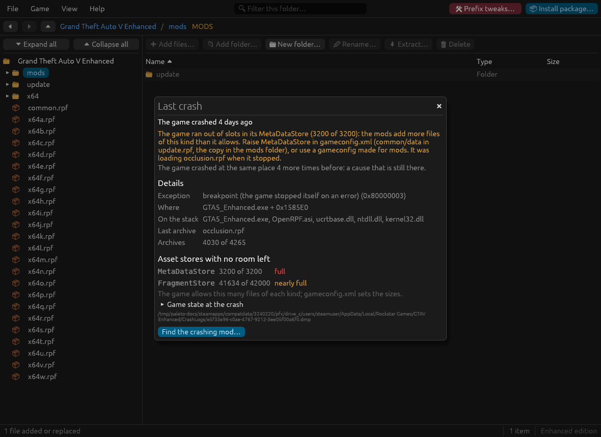

# When the game breaks

Tools for the usual questions: does the game load my mods, why did it crash, which mod is to blame, and how do I get back to a setup that worked. All of them are in the **Game** menu, and in the command line (see [cli.md](cli.md#checks-and-troubleshooting)).

- [Mods in game](#mods-in-game)
- [Last crash](#last-crash)
- [Find the crashing mod](#find-the-crashing-mod)
- [Snapshots of the mods folder](#snapshots-of-the-mods-folder)
- [Common problems](#common-problems)

## Mods in game

**Game → Mods in game** checks that the game will load your mods, and shows what it read the last time it ran.

**Setup**:

- the **ASI loader** (`dinput8.dll`, `xinput1_4.dll`…) is in the game folder;
- **`OpenIV.asi`** (Legacy) or **`OpenRPF.asi`** (Enhanced) is installed: without it the game ignores the mods folder;
- **Script Hook V** started with this game version. It is read from its own log, so after a game update it asks you to start the game once;
- **.NET in the Wine prefix** (Linux): whether ScriptHookVDotNet can run, and a warning when the prefix is set to a Windows the game refuses; see [mods.md](mods.md#scripthookvdotnet-mods-net-on-linux);
- **ASI plugins**: the list, with the ones older than the last game update marked, since they often stop working after one;
- the mods copy of `update.rpf` is **not older than the game**: after a game update its DLC list lacks the new packs, and the game does not load them. **Add them to the mods copy's DLC list** fixes it;
- **add-on packs missing from the DLC list**, which the game never loads; the same button adds them;
- on the Enhanced edition, **files made for Legacy**, with **Convert them to Enhanced** (see [mods.md](mods.md#legacy-files-on-the-enhanced-edition)) and **Undo the last conversion**.

**Clean-up**: copies of game files left unchanged in the mods folder; see [mods.md](mods.md#cleaning-up-the-mods-folder).

**Last game session**: the archives of the mods folder, each marked as read or not read by the game, from the log `OpenIV.asi` or `OpenRPF.asi` writes (found in the game folder or in the Proton prefix), with the errors it logged. An archive that was not read usually means a wrong path, or a pack missing from the DLC list.

## Last crash

When the game crashes it writes a crash dump (`.dmp`) and a `crashcontext.log`; under Proton they are in the game's prefix (`compatdata/3240220/…/Rockstar Games/GTAV Enhanced/CrashLogs` for Enhanced). **Game → Last crash** reads the newest one.

It shows:

- **a reading of the crash**, in plain words: a plugin on the stack to update or remove, a mod file the game could not read, or the graphics stack (driver, Proton);
- how many **earlier crashes happened at the same place**: a cause that is still there;
- **Details**: the exception, the module and offset it happened in, the address read or written, and the modules on the crashing thread's stack (`.asi` plugins among them are the usual suspects);
- **Asset stores with no room left**, from `crashcontext.log`: the game keeps a fixed number of slots for each kind of file (textures, models, metadata…). When a store is **full**, the game stops on the next file it has to register; the window lists the full stores and those within 2% of it. The fix is a larger pool in `gameconfig.xml` (`common/data` in the mods copy of `update.rpf`) or a gameconfig made for mods.
- **Last archive**: the last archive the game mounted before it stopped, with the add-on pack that holds it, found by hashing the names of the archives of your packs. It points at the mod that was loading.
- **Archives**: how many archives were mounted of how many the game allows. At the limit, a Packfile Limit Adjuster is needed.
- **Game state at the crash**, from `crashcontext.log`.

**Find the crashing mod…** starts a search when the reading points to the mods. When a store is full, the reading names it and the pack that was loading, which is usually enough without a search.

## Find the crashing mod

For a game that crashes when you do not know which mod causes it. **Game → Find the crashing mod**:

1. **Start**: half of the suspects are turned off. Suspects are the `.asi` plugins (except the one that reads the mods folder), the add-on packs, and the modified archives of the mods folder. Copies of game files left unchanged are not suspects.
2. You start the game and do what made it crash.
3. You answer **It crashed** or **It works**. Each answer halves the suspects, until one is left: about 6 game runs for 40 suspects.

The culprit stays turned off, so you can play to confirm it; then remove or update that mod. **Turn everything back on** (or **Stop**, at any time) puts everything back where it was.

Turned-off parts are moved to the game folder's `mods_disabled/` folder and back; the search survives closing the app.

**Look inside it**: when the culprit is an archive that holds several mods (the mods copy of `update.rpf` often does), the search can go on among its changed files. Files are turned off by putting the game's own version back in the archive, and restored afterwards. On a real Enhanced `update.rpf` with 621 changed files, this takes about 10 game runs, under half a second per step.

## Snapshots of the mods folder

**Game → Snapshots of the mods folder** keeps the whole mods folder as it is now, so you can go back to it when a change breaks the game. Take one before installing something big.

- **Save a snapshot**, with an optional note ("Before VisualV").
- **Restore…** replaces the mods folder with a snapshot. By default the current mods folder is saved as a snapshot first, so a restore can be undone too.
- **Delete** removes a snapshot; the mods folder stays as it is.

Snapshots are kept in the game folder's `mods_snapshots/`. On btrfs, XFS and bcachefs a snapshot is instant and takes no space until files change (60 GB in a third of a second); on other filesystems it is a full copy, as big as the mods folder. The window says which applies.

## Common problems

**The game ignores the mods folder.** Check **Mods in game → Setup**. Under Proton, the ASI loader needs a DLL override in the launch options, for example `WINEDLLOVERRIDES="xinput1_4=n,b" %command%` ([installation.md](installation.md#what-the-game-needs-to-load-your-mods)).

**A mod worked, then a game update broke it.** Look at **Mods in game**: the mods copy of `update.rpf` may predate the update (add the new packs to its DLC list), Script Hook V may need its new version, and plugins older than the update are marked.

**The Enhanced game crashes when a modded car or object appears.** Usually a model or texture made for Legacy. **Mods in game** lists them and converts them.

**An add-on pack does not show up in game.** It must be in the DLC list: **Mods in game** lists the packs that are not. Check also that the log shows its archive was read.

**ScriptHookVDotNet mods (a `scripts` folder with `.dll` files) do nothing, or the game stops at startup.** They need the real .NET Framework 4.8 in the game's Wine prefix: **Mods in game** says whether it is there, and **Game → Prefix tweaks…** installs it ([mods.md](mods.md#scripthookvdotnet-mods-net-on-linux)). If the game says "Support for Windows XP and Vista has ended", the prefix was left on an old Windows version; the same tool sets it back.

**Steam reports changed files.** Paleto Modkit edits only the mods folder, but other tools (or deleting game files outside `mods/` by hand) may change the game's own files. **Verify integrity of game files** in Steam puts them back; your mods folder is not touched by it.
