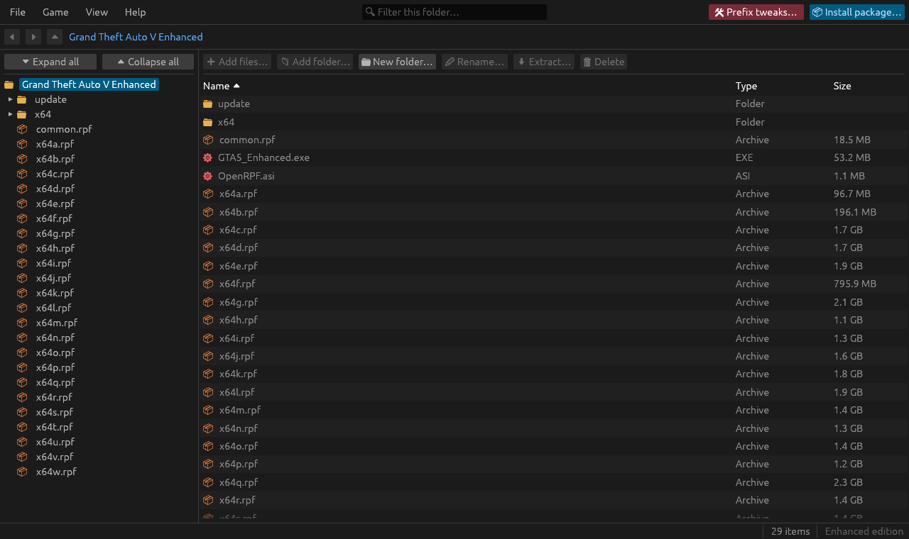
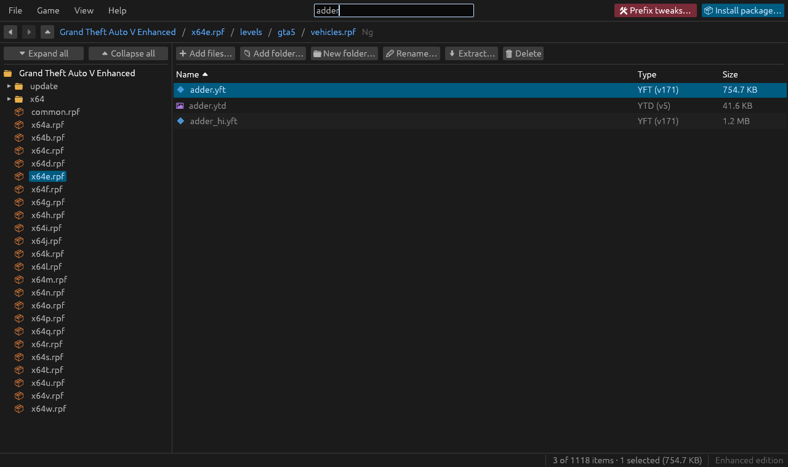
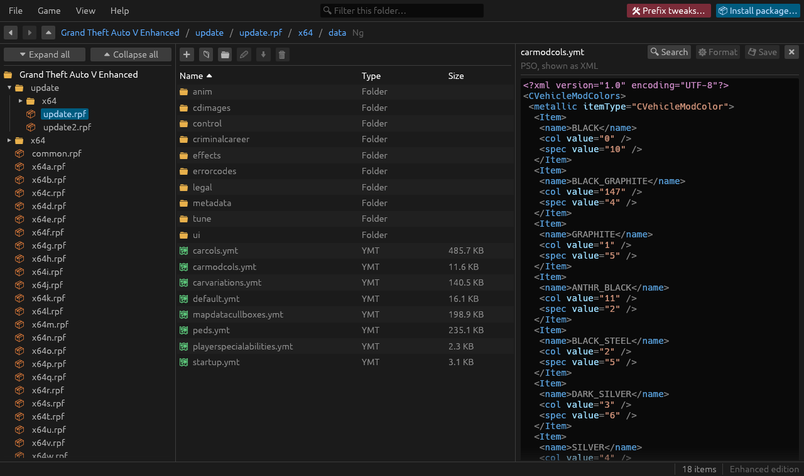
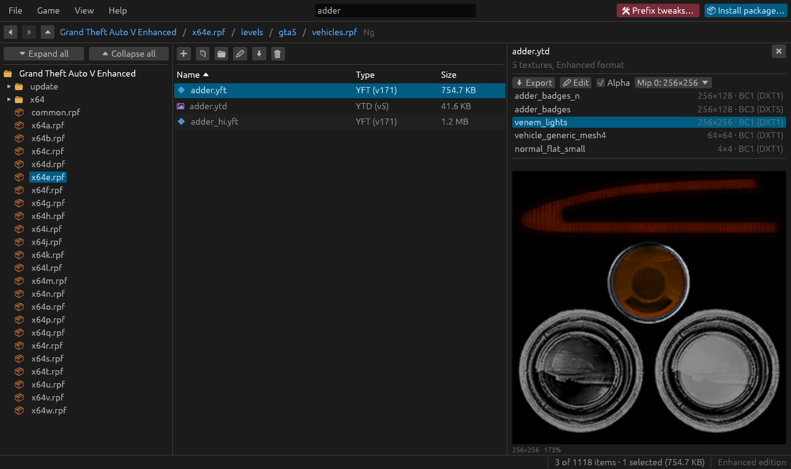
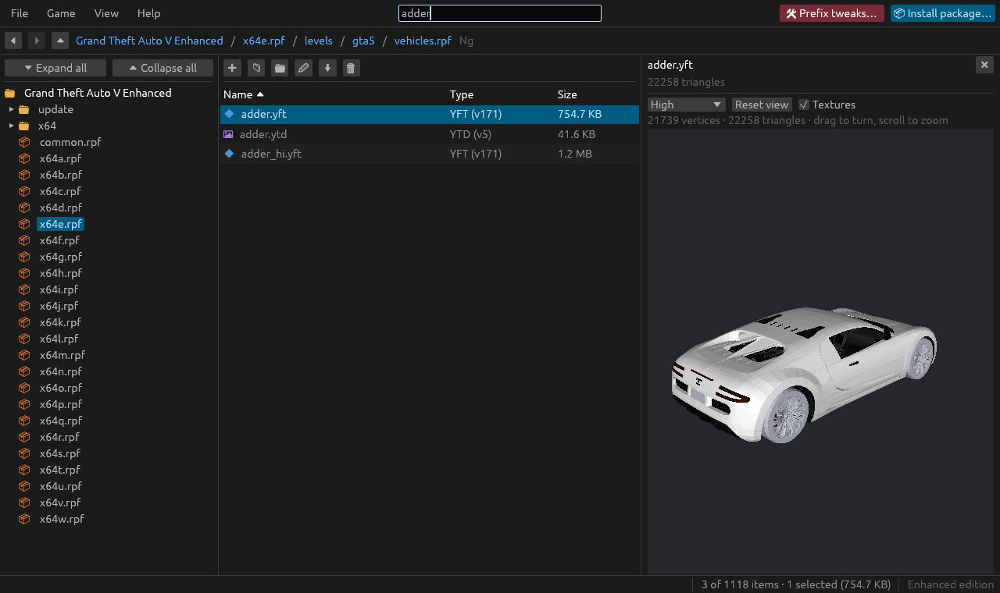
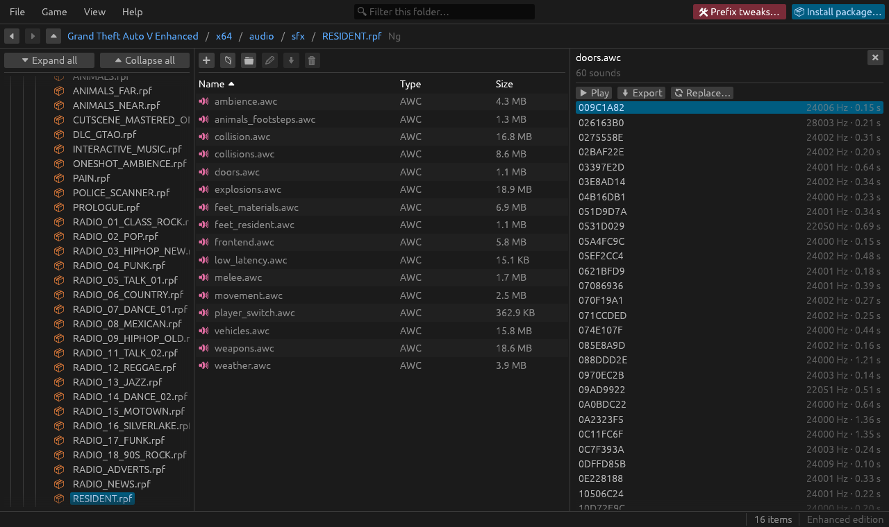

# User guide

How to browse the game files and change them with the desktop app. For installing mods and keeping them working, see [mods.md](mods.md) and [troubleshooting.md](troubleshooting.md).

- [The window](#the-window)
- [What the colours mean](#what-the-colours-mean)
- [Browsing](#browsing)
- [Editing archives](#editing-archives)
- [Files and folders outside archives](#files-and-folders-outside-archives)
- [Text and XML files](#text-and-xml-files)
- [Binary metadata and text tables](#binary-metadata-and-text-tables)
- [Textures](#textures)
- [3D models](#3d-models)
- [Audio](#audio)
- [Keyboard and mouse](#keyboard-and-mouse)
- [Appearance](#appearance)

## The window

- **Menu bar**: File, Game, View and Help. The filter box sits in the middle; **Install package…**, the most common action, is at the right end.
- **Location bar**: back, forward and up buttons, then the path as clickable parts. Inside the mods copy of an archive, the path shows **MODS**, and **Show original** at the right end shows the game's own archive instead (marked **ORIGINAL**; **Show mods copy** goes back). This lasts until you leave that archive.
- **Side tree**: the game folder. Click a name to open it, its arrow to expand it. **Expand all** and **Collapse all** are above it. **View → Side tree** hides it when you want the room for the file list.
- **File list**: the open folder or archive folder, with its toolbar (add, new folder, rename, extract, delete). Click a column header to sort by it.
- **Preview panel**: opens on the right when you select a file: text, XML, textures, models or sounds.
- **Status bar**: what is running and the result of the last operation on the left. On the right: how many items the folder holds and what is selected (with its size), the files of the mods folder made for Legacy on the Enhanced edition (until they are converted; click the count to see them), and the edition (the game folder on hover).

Paleto Modkit finds the games installed in your Steam libraries. **Game → Choose the game folder…** picks any other install (the folder holding `GTA5.exe` or `GTA5_Enhanced.exe`). Both editions are supported; the status bar says which one is open.

## What the colours mean

| Cue | Meaning |
| :--- | :--- |
| **Orange name with ↪** | **Modded**: a game archive or file with a copy in the `mods/` folder, which the game loads instead. Opening the archive shows that copy (the path shows **MODS**), so you see what the game actually loads. |
| **Orange name** | Inside a mods copy: a file that differs from the game's, or is not in it; hover over it to see which. |
| **Plain name** | **Original**: an untouched game file. **Show original** in the location bar shows one archive's original; **View → Show original files** shows the originals everywhere, ignoring the mods folder. |
| **Icon colour** | **File type**: folders, archives, textures, models, maps, audio, executables and text each have their own colour. **View → Coloured icons** turns them off. |

## Browsing

Double-click an archive (`.rpf`), or select it and press **Enter**, to open it like a folder. Archives inside archives open the same way, as deep as they go.

**Type to filter**: start typing anywhere and the list shows only the names that contain what you typed; the first match is selected, so **Enter** opens it. **Esc** clears the filter.

**File → Open archive…** opens an archive outside the game folder, for example one that came with a mod. You can also open `.rpf` and `.oiv` files from your file manager.

## Editing archives

Inside an archive, the toolbar, the right-click menu and drag and drop:

- **Add files…** and **Add folder…**, or drop files and folders on the window: they are added to the open folder, replacing files with the same name. A folder keeps its structure.
- **New folder…** (Ctrl+Shift+N), **Rename…** (F2), **Delete** (Delete key).
- **Extract…**: copies the selection, folders included, to a folder you pick.

**Original game files are never modified.** The first change to an original archive copies it to the `mods/` folder (at the same place: `update/update.rpf` becomes `mods/update/update.rpf`) and changes the copy. On btrfs and XFS the copy is a reflink: instant, and taking no extra space until it differs. Archives you opened from outside the game folder are edited in place.

Names inside archives are stored in lower case, as the game expects.

On the Enhanced edition, files made for Legacy are noticed when you add them, and can be converted on the way; see [mods.md](mods.md#legacy-files-on-the-enhanced-edition).

## Files and folders outside archives

In the game folder itself, **New folder…**, **Rename…** and **Delete** work on the files on disk. Deleting there is permanent (there is no trash): the confirmation says so, and warns in red when the files are game files outside `mods/`, which Steam would have to download again (**Verify integrity of game files**). Adding and extracting only work inside archives.

On disk, a rename that only changes upper and lower case is allowed. A name already used in the folder, in any case, is not: the game does not tell them apart.

## Text and XML files

Selecting a text file shows it in the preview panel, where you can edit it:

- syntax highlighting for XML (`.xml`, `.meta`) and configuration files (`.ini`, `.cfg`, `.dat`, `.ide`…);
- **💾 Save** (Ctrl+S) writes it back into the archive (into its mods copy, for an original);
- **⚙ Format** re-indents messy XML. Only whitespace changes;
- **🔍 Search** (Ctrl+F) finds text in the file, whatever its case: matches are highlighted, **Enter** goes to the next one, **Shift+Enter** to the previous one, **Esc** closes the search. It works on read-only files too.

On a narrow panel the three buttons shrink to their icons (names on hover).

Leaving a file with unsaved changes asks whether to save them, discard them or stay.

## Binary metadata and text tables

`.ymap`, `.ytyp`, `.ymt` and `.pso` files (resource, PSO and RBF metadata) open as editable XML, in the same format as CodeWalker. Saving converts the XML back to the binary format.

Text tables (`.gxt2`) open as `0xHASH = text` lines, one per string, and are converted back the same way.

## Textures

Selecting a texture dictionary (`.ytd`) shows its textures, with their format, size and mipmaps. **Alpha** shows their transparency over a checkerboard.

- **⬇ Export**: the selected texture or all of them, as DDS or PNG.
- **✏ Edit**:
  - **Replace with DDS or PNG…**: a DDS file is used as it is, with its own format and mipmaps; a PNG picture is compressed to the texture's format (BCn), with mipmaps generated when the size is a power of two.
  - **Replace from several files…** and **Replace from a folder…**: many mods ship a folder of DDS files named after the textures they replace (for example for `fxdecal.ytd`). Each file replaces the texture it is named after; files that match no texture can be added as new ones. Dropping the folder on an open dictionary does the same.
  - **Add texture…**, **Rename…**, **Remove**.

New textures from PNG pictures become BC1, or BC3 when they have transparency. The command line can pick another format; see [cli.md](cli.md#textures).

## 3D models

Selecting a model (`.ydr`, `.yft`, `.ydd`) shows it in 3D, with its textures: its own, the ones vehicles share (`vehshare.ytd`) and the parent dictionaries the game links them to, DLC packs and tuning parts included. Drag to turn it, scroll to zoom, and **Reset view** to start over. Vehicle parts and wheels are shown in place.

## Audio

Selecting an audio container (`.awc`) lists its sounds.

- **▶ Play** and **⏹ Stop**.
- **⬇ Export**: the selected sound or all of them, as WAV.
- **🔄 Replace…**: replaces the selected sound with a WAV or MP3 file, converted to the sound's format and rate. Radio songs are streams of several channels: a stereo file replaces both channels at once. On the Enhanced edition streams are MP3, one mono MP3 per channel.

## Keyboard and mouse

| Keys | Action |
| :--- | :--- |
| Typing | Filter the open folder |
| ↑ / ↓ | Move the selection |
| Enter, double-click | Open a folder or archive, preview a file |
| Backspace | Go up one level |
| Alt+← / Alt+→, mouse side buttons | Back / forward |
| Ctrl+click, Shift+click | Select several items |
| Delete | Delete the selection |
| F2 | Rename the selected item |
| Ctrl+Shift+N | New folder |
| F5 | Read the folders again (the list also refreshes by itself after every change) |
| Ctrl+S | Save the file being edited |
| Ctrl+F | Search in the text being previewed |
| Esc | Clear the filter, close dialogs |
| Right click | Actions for the item |

**Help → Keyboard and mouse shortcuts** shows the same list in the app.

Dropping on the window:

- files and folders: added to the open archive folder;
- DDS or PNG files on an open texture dictionary: they replace the textures they are named after;
- an `.oiv` package: opens the installer;
- a `dlc.rpf`, or a mod's folder holding one: installs it as an add-on pack (see [mods.md](mods.md#add-on-packs)).

## Appearance

The **View** menu:

- **Theme**: light, dark, or the same as the desktop (followed live, also on Wayland).
- **Text and icon size** and **Density** (row spacing).
- **Folders and files**: folders first, grouped by type, or mixed.
- **Side tree** shows or hides the tree of the game folder; **Coloured icons**; **Show all files in the side tree** (by default it shows folders and archives only); **Remember open folders** (the side tree opens as you left it).
